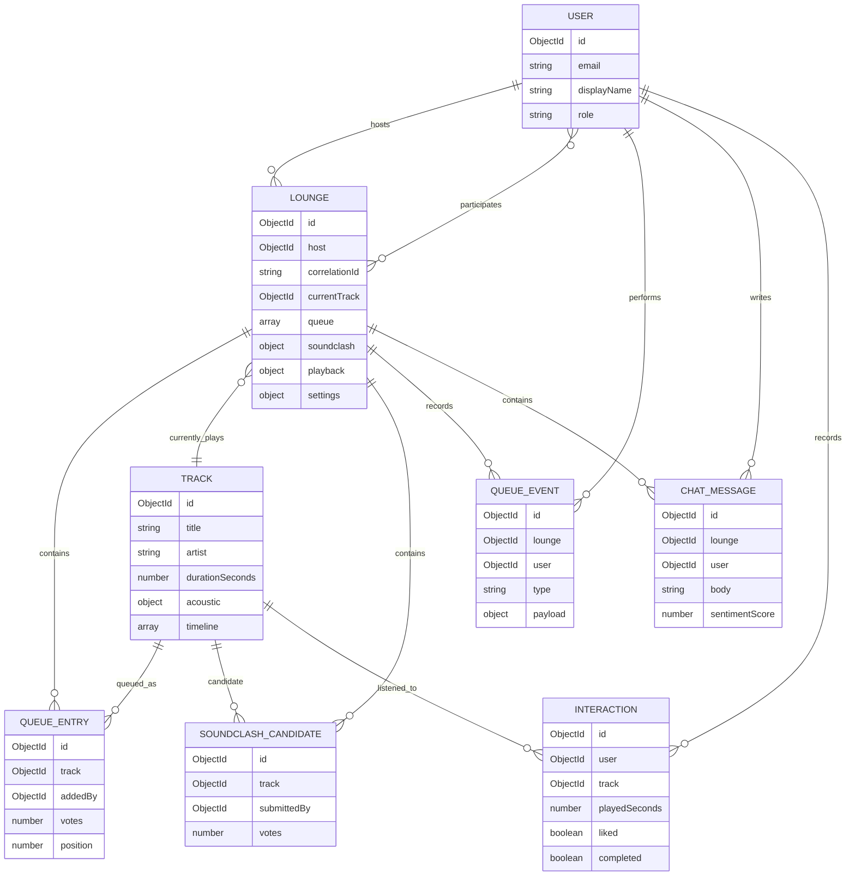

# Architecture

## Chosen delivery track

Track A — full-stack web application. The stack is React/Vite, JavaScript, Express,
Socket.IO, MongoDB, and Mongoose.

## Runtime shape

```text
React client
  ├─ REST (JWT bearer token + HttpOnly refresh cookie) ── Express API
  └─ Socket.IO (JWT handshake, lounge room) ──────────── Socket handler
                                                           │
                                      Mongoose ─────────────┤
                                                           ▼
                                                      MongoDB
```

The Express HTTP server and Socket.IO gateway share one process and Mongoose connection.
Socket.IO rooms are keyed by lounge ID. The lounge document is authoritative for the
current track, ordered queue, Soundclash state, presence membership, and playback state.
Queue mutations use MongoDB updates and version checks; the current implementation does
not maintain an in-memory queue state machine or batch event writes.
Each lounge has a persistent correlation ID. Completed API requests emit structured JSON
logs with a request ID, session correlation ID, user/lounge identifiers, operation
category, status, and duration; request bodies, chat text, and AI prompts are excluded.
`GET /health/queue-gateway` reports database/gateway readiness and connected socket count.

## Data model



Co-DJ is a per-lounge assignment rather than a global user role. The global user schema
also supports listener, host, and admin roles.

## Main event flows

### Queue and playback

1. A participant submits a queue entry through the REST API.
2. The server validates lounge membership/lock state, adds the entry to the lounge
   document, then broadcasts `lounge:queue:update`.
3. Votes are applied atomically and the queue is sorted server-side before broadcast.
4. The host's audio element reports playback progress over Socket.IO. At the configured
   outro window, the host client requests an AI segue; the server checks only queued
   tracks and broadcasts the selected track and reason.
5. When the current audio ends, the host client applies the still-queued AI selection.
   If it is no longer applicable, it advances the regular queue. Listener clients follow
   the resulting `lounge:nowplaying:update` and `lounge:playback:update` events.

### Soundclash

Listeners submit 2–4 total candidates. Host/admin opens a timed battle; listeners vote.
A server-side scheduler resolves expired battles, inserts the winner into the queue, and
broadcasts the result. Scheduler interval is five seconds.

### Chat and sentiment

The REST chat endpoint validates and persists each message, scores it with a deterministic
keyword matcher, recalculates a recent-message rolling score, and broadcasts both the
message and sentiment update. The score is used by AI segue ranking.

## Authentication and permissions

REST endpoints use access JWTs (maximum one hour); refresh tokens are rotated in an
HttpOnly cookie and stored as hashes. Socket.IO verifies the access JWT during handshake
and checks lounge membership on join and sensitive actions. Host/Co-DJ controls are
enforced by server middleware/services; listeners can remove only their own queued items.
Unexpected host disconnects set a visible room flag and freeze queue/Soundclash controls
until the host reconnects.

## Deliberate limitations

- Transition text and Q&A are deterministic metadata-grounded logic, not a hosted LLM.
- Seed audio consists of short clips and its acoustic fields are development/demo data;
  two profiles are explicitly flagged `demoOnly`.
- Playback synchronizes positions but does not process waveforms or crossfade.
- Realtime authority is persisted in MongoDB rather than an in-memory queue gateway.
- Performance and sentiment-accuracy thresholds have not been measured against the PRD's
  target datasets/load. A small synthetic recommendation holdout is documented separately
  and is not representative production interaction data.
