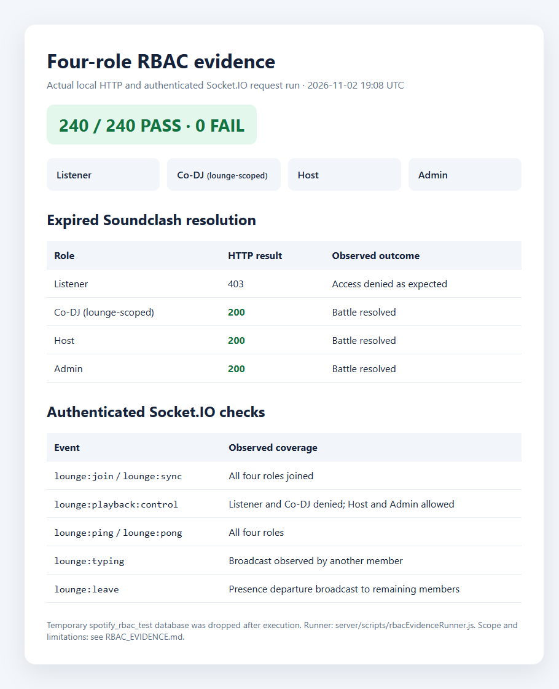

# Four-Role RBAC Evidence

## Run summary

- **Run:** 2026-11-02 19:08 UTC
- **Result:** 240 of 240 expected outcomes; 0 failures
- **Transport:** Actual HTTP requests and authenticated Socket.IO WebSocket events
  against the local Express server
- **Database:** Fresh local `spotify_rbac_test`; test data and database removed
  after the run
- **Accounts:** Listener, Co-DJ, Host, Admin, plus a non-member used to verify
  lounge membership guards
- **Co-DJ scope:** The Co-DJ test account retained global role `listener`; Host
  assigned it as Co-DJ in the test lounge.

Run again from `server` with `node scripts\rbacEvidenceRunner.js`. It requires
local MongoDB and the client dependencies (for `socket.io-client`). The runner
refuses to use a non-empty `spotify_rbac_test` database and drops its temporary
database after the test. Do not change the URI to a development or production
database.

Visual summary: [RBAC_EVIDENCE_VISUAL.html](./RBAC_EVIDENCE_VISUAL.html).
Screenshot captured from that report:

## Permission results

These are actual results from the runner. A denial is successful when the
observed response matches the policy expectation.

| Action | Listener | Co-DJ | Host | Admin |
|---|---:|---:|---:|---:|
| Join lounge | 200 PASS | 200 PASS | 200 PASS | 200 PASS |
| Add queue track / vote | 200 PASS | 200 PASS | 200 PASS | 200 PASS |
| Remove another user's queue item | 403 PASS | 200 PASS | 200 PASS | 200 PASS |
| Advance queue | 403 PASS | 200 PASS | 200 PASS | 200 PASS |
| Set lounge live | 403 PASS | 403 PASS | 200 PASS | 200 PASS |
| Lock/unlock lounge | 403 PASS | 403 PASS | 200 PASS | 200 PASS |
| Mute/remove participant | 403 PASS | 403 PASS | 200 PASS | 200 PASS |
| Transfer host | 403 PASS | 403 PASS | 200 PASS | 200 PASS |
| Upload/moderate track | 403 PASS | 403 PASS | 403 PASS | 201/200 PASS |
| Resolve expired Soundclash | 403 PASS | 200 PASS | 200 PASS | 200 PASS |

The expired Soundclash resolution returned `200` and a resolved winner for
Co-DJ, Host, and Admin. Listener received `403`. This test creates an expired
battle with candidates and votes before each authorized resolution request.

The runner also exercised user and lounge reads, recommendations, chat and
reactions, AI DJ compatible-track/segue/Q&A routes, analytics, queue operations,
Soundclash candidate submission/removal/open/vote, lounge moderation, leave and
rejoin, and non-member denials for the documented member-gated API routes.
Authenticated sockets exercised lounge join/sync, playback control, ping/pong,
typing updates observed by another member, and leave/presence broadcasts.

For playback control, Listener and Co-DJ received the Host-only error; Host and
Admin produced a `lounge:playback:update`. Co-DJ's global role was checked as
`listener`, confirming that its elevated permissions are lounge-scoped.

## Scope and limits

- The 240 outcomes cover the actions and routes/events encoded in
  `server/scripts/rbacEvidenceRunner.js`; they are not a claim that every
  application endpoint, input variation, or Socket.IO event was tested.
- Results are repeatable local request evidence, not screenshots of a live
  multi-user browser session.
- A successful expired-battle resolution is now covered. A complete recorded
  product walkthrough (queue voting, AI segue/Q&A, Soundclash, and sentiment
  shift) remains separate demo evidence.
